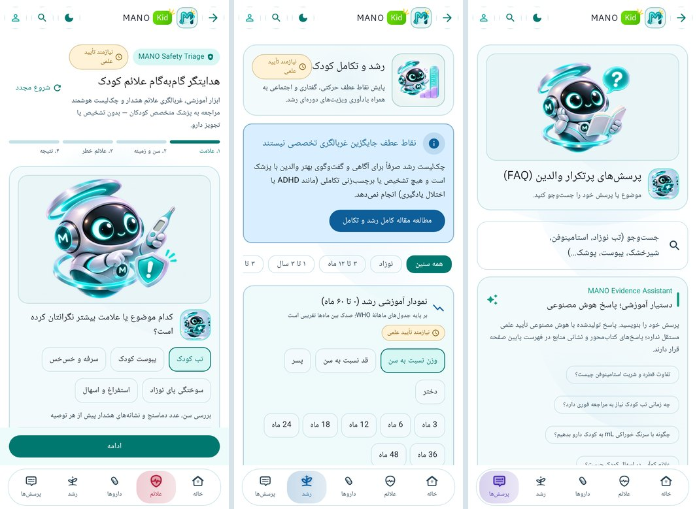

# بازبینی نسخهٔ اندروید Manokid

مبنای بررسی، نسخهٔ ۱۳ در main با شناسهٔ `233b8d1` و اصلاحات شاخهٔ بازبینی تا `bf5837e` بود. مسیرهای زیر در کد اندروید و درگاه مشاورهٔ سرور بررسی شدند.

| مسیر خانواده | مراحل بررسی | تغییر قابل مشاهده |
|---|---|---|
| شروع و پروفایل کودک | رضایت، تاریخ تولد، وزن اختیاری، ذخیره و ورود به ابزار | پیش‌نمایش آغاز برنامه از گروه سنی حجم دارو تولید نمی‌کند. وزن اختیاری در فرم پروفایل، در صورت ثبت، باید معتبر و دارای تاریخ اندازه‌گیری باشد. |
| راهنمای علائم | انتخاب علامت، سن، دما، مدت، هشدار، نتیجه و شروع دوباره | تب شیرخوار زیر سه ماه در مسیر سرفه نیز ارزیابی فوری دارد. سن دقیق شیرخوار برای تفکیک آستانهٔ ۳۹ قابل ورود است. مدت منفی یا اعشاری پذیرفته نمی‌شود. |
| پرسش از داروساز | بررسی پیام، صلاحیت دریافت مجوز، ثبت پرونده و دسترسی کارکنان | سرور شناسه‌های همان فرم اندروید را تشخیص می‌دهد. برای علامت هشدار یا مدت طولانی تعریف‌شده مجوز غیرفوری صادر نمی‌کند. مسیر مستقل ثبت پرسش، شرح متنی و گزارش وضعیت فوری را می‌فرستد و تمام اندازه‌گیری‌های فرم علائم را منتقل نمی‌کند. |
| رشد | انتخاب جنس نمودار و سن، ورود وزن یا قد، تأیید روش، مشاهدهٔ نتیجه | عدد بدون ورودی کافی نمایش داده نمی‌شود. تا قبل از ۲۴ ماه، طول خوابیده و از ۲۴ ماه، قد ایستاده استفاده می‌شود. صدک بین ماه‌ها تقریبی است. |
| سرنگ و داروی مایع | انتخاب غلظت، ورود سن و وزن، تطبیق برچسب، نمایش حجم و انتقال به تمرین سه‌بعدی | سن و وزن فرضی حذف شدند. سرنگ دیگر وزن کودک را از جابه‌جایی پیستون حدس نمی‌زند. مقدار خارج از ظرفیت سرنگ به سقف ابزار بریده نمی‌شود. نتیجهٔ سیتیریزین ۲٫۵ میلی‌گرمی نیز به ۳ میلی‌گرم گرد نمی‌شود. |
| پرسش‌ها | جست‌وجوی فارسی، فیلتر، باز کردن پاسخ و مشاهدهٔ منبع | هشت پاسخ مرجع‌دار افزوده شد. منبع همراه پاسخ هوش مصنوعی از محتوای ارسالی برنامه انتخاب می‌شود. هر پاسخ تولیدشده وضعیت تأیید مستقل خود را نشان می‌دهد. |
| تصویر و آیکون | مقایسه با ربات Orbit مخزن و مشاهدهٔ سه فایل نهایی روی زمینهٔ روشن و تیره | علائم با دماسنج و سپر، رشد با خط‌کش و مکعب، پرسش‌ها با کتاب و حباب سؤال نمایش داده می‌شود. تصاویر WebP شفاف هستند. |
| اسکنر شربت و تمرین سه‌بعدی | انتخاب دستی بطری، تطبیق غلظت، تأیید والد و باز کردن سرنگ سه‌بعدی | تأیید بطری به تنهایی حجم مصرف ایجاد نمی‌کند. مسیر انتقال با پروفایل دارای سن و وزن مشخص آزموده شد. |
| واکسن و پیگیری | ورود تاریخ شمسی، یادآور، ثبت دریافت، تغییر وضعیت و بازخوانی | تاریخ‌ها، کار زمان‌بندی‌شده و دادهٔ ذخیره‌شده در آزمون اندروید بررسی شد. تحویل واقعی اعلان به گوشی نیاز به آزمون جداگانه دارد. |
| دارو، تغذیه و پرونده | جست‌وجوی نام و مترادف، بررسی هم‌پوشانی دارو، فرم تغذیه، ثبت و بازخوانی ویزیت | صفحات و منطق محلی با دادهٔ آزمایشی اجرا شدند. برای فرم‌های هوش مصنوعی، پاسخ کنترل‌شده به کار رفت. |

## شواهد علمی

در *Nelson Essentials of Pediatrics*، ویرایش ۸، فصل‌های رشد و تکامل، تب، گاستروانتریت و یبوست بررسی شدند. در *Applied Therapeutics: The Clinical Use of Drugs*، ویرایش ۱۲ با حق نشر ۲۰۲۴، بخش‌های مرتبط فصل ۱۰۴ دربارهٔ مصرف دارو، تب، سرماخوردگی، راش پوشک و ORS بررسی شدند. شمارهٔ فصل، صفحهٔ چاپی در موارد در دسترس و صفحهٔ فایل در [ارجاع‌های داخل برنامه](../app/src/main/java/com/example/data/ManoTextbookEvidence.kt) ثبت شده است. برای آستانه‌های تب، [راهنمای NICE](https://www.nice.org.uk/guidance/ng143/chapter/Recommendations) و برای داده‌های رشد، [شش جدول اصلی WHO](WHO_REFERENCE_PROVENANCE.json) به کار رفتند.

هر پنج مسیر علائم و هشت پاسخ افزوده‌شده وضعیت «نیازمند تأیید علمی» دارند. تطبیق اعداد رشد شامل ۲۴۶ ردیف و هفت ستون عدد مرجع در هر ردیف است. ارزیابی منحنی فردی، تطبیق غلظت فرآورده‌های موجود در ایران و تأیید بالینی تغییرات جداگانه انجام می‌شوند.

## نتیجهٔ اجرا

در درخت کد `df30192`، ۱۲۲ آزمون اندروید در ۱۸ کلاس و ۱۵ آزمون Functions موفق شدند. اجرای اندروید شامل آزمون‌های Kotlin و رابط Compose با Robolectric و آزمون‌های پایگاه داده با شبیه‌ساز محلی Firestore و Auth بود. نمونه‌های بررسی‌شده شامل فرم با ارقام فارسی، سن و وزن خالی، تب زیر سه ماه، بازگشت از صفحات داخلی، صدک رشد با قد ایستاده، تطبیق غلظت اسکنر، ورود به تمرین سه‌بعدی و متن با بزرگ‌نمایی ۲۰۰٪ بودند. ۱۷۲۲ مقایسهٔ عددی WHO بخشی از همین آزمون‌هاست.

ورود واقعی با گوگل، سرویس زندهٔ هوش مصنوعی، دوربین گوشی، تحویل اعلان روی دستگاه و عملکرد TalkBack روی سخت‌افزار واقعی در این اجرا سنجیده نشدند. محتوا و قواعد بالینی اصلاح‌شده برای بازبینی انسانی آماده‌اند. نسخه در شاخهٔ بازبینی باقی مانده است.

## نمای داخل برنامه

این سه نما از خود صفحه‌های Compose در Robolectric با زبان فارسی و عرض ۴۱۱dp گرفته شده‌اند. از چپ به راست، صفحهٔ علائم، رشد و پرسش‌ها دیده می‌شود. خروجی Debug نیز با موفقیت ساخته شد.

