# بازبینی انتقادی ساختار و تجربهٔ کاربری مانو

تاریخ: ۲۷ نوامبر ۲۰۲۶. این گزارش تغییرات اجراشده، شواهد تصویری و محدودیت‌های بررسی را ثبت می‌کند. صفحهٔ اصلی، اپ React فارسی و راست‌به‌چپ است و طرح پیشین در `/preview/` باقی می‌ماند.

نتیجهٔ اصلی این مرحله، روشن‌تر شدن مسیرهای شروع و حذف نشانه‌هایی است که می‌توانستند تأیید بالینی، نسخهٔ واقعی یا قابلیت آنلاینِ فعال را القا کنند. این تغییرات، اثبات افزایش فهم، اعتماد، نرخ تبدیل یا ماندگاری کاربران نیستند؛ چنین پیامدهایی هنوز با کاربران واقعی اندازه‌گیری نشده‌اند.

**مرز استفاده:** محصول همچنان پیش‌نمایش آموزشی با محتوای بالینیِ نیازمند تأیید مسئول بالینی است. برای تصمیم درمانی یا ثبت اطلاعات واقعی بیمار استفاده نشود. هوش مصنوعی و تحلیل آنلاین تصویر در مرورگر غیرفعال‌اند. انتشار عمومی یا تأیید بالینی بخشی از این مرحله نبوده است.

## نسخه‌ها و روش بررسی

| مرحله | نسخهٔ قابل بازیابی در `main` | نتیجه |
|---|---|---|
| مبنای تصاویر «قبل» | [`d8b2982`](https://github.com/mhmpharmacy-tech/Mano/commit/d8b2982bf78c12d0672d2cbffa41c0cdfd30336e) | ادغام اصلاحات پیشین ایمنی و حریم خصوصی |
| قرارداد ناوبری | [`9d53040`](https://github.com/mhmpharmacy-tech/Mano/commit/9d53040b0fe874c567644d4ba23bb567f274df49) | جداسازی مسیرها و بازگشت امن از هش نامعتبر |
| صداقت برنامهٔ مراقبت | [`dda77a1`](https://github.com/mhmpharmacy-tech/Mano/commit/dda77a18036987e45545b6f2273910e4938985dd) | حذف نسخهٔ پیش‌فرض و تأیید ساختگی؛ حفظ داده‌های قبلی در مهاجرت |
| ساختار و رابط جدید | [`079a62e`](https://github.com/mhmpharmacy-tech/Mano/commit/079a62e0d670323bec55182eb7a55b43dbf3bf2b) | ۹۰ آزمون و مجموعهٔ کامل Chromium روی نسخهٔ جداشده موفق |
| تکمیل رفتار پنجره‌های مراقبت و هشدار | [`6fe0e4e`](https://github.com/mhmpharmacy-tech/Mano/commit/6fe0e4ef8753f2c1779cf1f58c000ede0023e15a) | ۹۰ آزمون، ساخت تولید و مجموعهٔ کامل Chromium شامل دو پنجرهٔ کوتاه‌نما موفق |

هر ۱۴ تصویر PNG این گزارش، تازه از اجرای محلی اپ در Chromium گرفته و مشاهده شدند. مبنای موبایل، عرض ۳۹۰ و ارتفاع نمای دید ۸۴۴ پیکسل است؛ تصویر مکمل هشدار، نمای ۳۲۰ × ۴۸۰ دارد. تصاویر بلند، ثبت تمام صفحه‌اند؛ نوار ثابت پایین و پس‌زمینهٔ پنجره‌ها ممکن است در آن‌ها همراه کل صفحه دیده شوند. از تصویر به‌تنهایی نمی‌توان ترتیب تمرکز، قابلیت صفحه‌خوان یا امکان تعامل با پس‌زمینه را نتیجه گرفت؛ این موارد جداگانه در DOM و آزمون مرورگر بررسی می‌شوند. همهٔ داده‌ها نمونه یا ساختگی‌اند و هیچ دادهٔ واقعی بیمار برای این بررسی استفاده نشد.

## پنج گام تجربهٔ کاربر

### ۱. ورود و آشنایی اختیاری

**سلامت مسیر: بهبود یافته؛ بررسی صفحه‌خوان باقی است.** تصویر «قبل» با عبارت‌های «مراقبت علمی»، «دوز ایمن» و تأکید بر منابع معتبر شروع می‌شد، در حالی که تأیید بالینی این پیش‌نمایش کامل نشده بود. بررسی تعامل نیز نشان داد تمرکز در پنجره محصور نمی‌شد. نقطهٔ قوت قابل حفظ، معرفی کوتاه سه‌گامی، شخصیت بصری مانو و امکان رد کردن آشنایی بود.

در نسخهٔ جدید، آموزشی بودن، محدودیت استفاده و غیرفعال بودن قابلیت‌های آنلاین با زبان مستقیم بیان می‌شود. «رد کردن» برجسته است؛ خروج با Escape نیز آشنایی را کامل می‌کند. پنجره در نمای کوتاه قابل پیمایش است و هر گام، عنوان قابل تمرکز دارد. مؤلفهٔ مشترک پنجره، تمرکز اولیه، محصور کردن Tab، غیرفعال کردن پس‌زمینه و بازگرداندن تمرکز را انجام می‌دهد. این رفتارها جای آزمون واقعی با صفحه‌خوان فارسی و بزرگ‌نمایی سیستم‌عامل را نمی‌گیرند.

پیاده‌سازی: [ManoOnboardingOverlay.tsx](../src/components/ManoOnboardingOverlay.tsx)، [AccessibleDialog.tsx](../src/components/AccessibleDialog.tsx).

قبل — ثبت تمام صفحه با پنجرهٔ آشنایی در بالای آن:

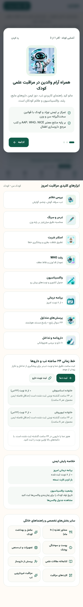

بعد — نمای دید ۳۹۰ × ۸۴۴:

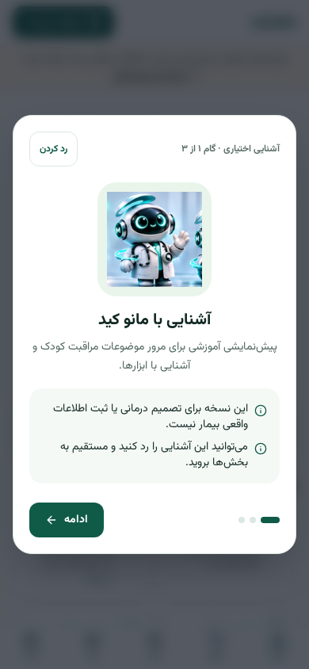

### ۲. انتخاب کار اصلی از خانه

**سلامت مسیر: مسیر شروع روشن‌تر شده؛ موفقیت کاربران هنوز سنجیده نشده است.** خانهٔ قبلی دو اقدام اصلی داشت، اما متن معرفی طولانی، نام و نشان حرفه‌ای، انتخاب حالت نمایش و فهرست‌های تکراری ابزارها با آن‌ها رقابت می‌کردند. عبارت «بر پایه شواهد بالینی» نیز می‌توانست آمادگی بیشتر محصول را القا کند. نقاط قوت حفظ‌شده، دو مسیر «بررسی علائم» و «حجم دارو»، هویت تصویری، نمایش وضعیت نامعلوم سن و دسترسی مستقیم به ثبت دما هستند.

در خانهٔ جدید، دو اقدام اصلی زودتر دیده می‌شوند؛ پروندهٔ کودک اختیاری است و قبل از مرور ابزارها درخواست ثبت‌نام وجود ندارد. چهار ابزار روزانه جدا شده‌اند و ابزارهای دیگر در گروه‌های بازشدنی با عنوان و توضیح باقی مانده‌اند. «ثبت‌های امروز» از دادهٔ موجود ساخته می‌شود؛ نبود برنامه، سن یا تاریخ تولد با عدد یا پیشرفت نمایشی جایگزین نمی‌شود. وضعیت‌های خالیِ تکراری خط زمانی فقط در نمای فشرده حذف شده‌اند؛ ورودی‌های ثبت و هشدارهای مربوط به رویدادهای موجود حفظ شده‌اند.

در ثبت تمام صفحه با عرض یکسان ۳۹۰، ارتفاع خانه از ۲۸۴۰ به ۱۸۱۰ پیکسل رسیده است. این فقط ویژگی دو تصویر ثبت‌شده است و معیار کاهش بار شناختی یا افزایش تبدیل نیست. آزمون مرورگر روی نسخهٔ جداشده، دیده شدن هر دو اقدام در نمای نخستِ عرض‌های ۳۶۰ و ۴۱۲، دسترسی به گروه‌ها، حفظ هش هنگام استفاده از پیوند رفتن به محتوا و بازآرایی متن بزرگ را تأیید کرد.

پیاده‌سازی: [HomeScreen.tsx](../src/screens/HomeScreen.tsx)، [FeverDoseTimelineCard.tsx](../src/components/FeverDoseTimelineCard.tsx)، [AppShell.tsx](../src/components/AppShell.tsx).

قبل — تمام صفحه:

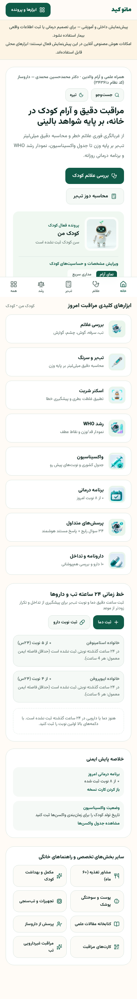

بعد — تمام صفحه:

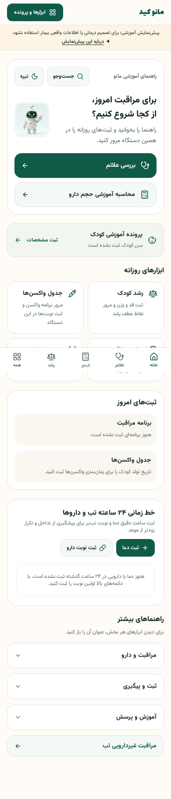

بعد — نمای نخست بدون پیمایش:

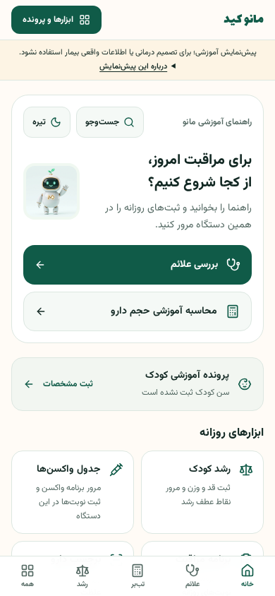

### ۳. پیدا کردن ابزار و جست‌وجو

**سلامت مسیر: بهبود یافته؛ انطباق کامل دسترس‌پذیری ادعا نمی‌شود.** فهرست قبلی ۱۶ مقصد را پشت سر هم نمایش می‌داد. برچسب‌هایی مانند «اسکنر هوشمند»، یادآور و پاسخ AI با قابلیت‌های واقعاً در دسترس هم‌خوان نبودند. در بررسی تعامل، باز شدن منو تمرکز را در پس‌زمینه رها می‌کرد. نقطهٔ قوت حفظ‌شده، دسترسی به همهٔ مقصدها و جست‌وجو از یک مکان است.

فهرست جدید همان ۱۶ مقصد را در چهار گروه نشان می‌دهد. نام و توضیح هر ابزار در [featureCatalog.ts](../src/navigation/featureCatalog.ts) متمرکز شده تا خانه و منو دربارهٔ قابلیت واحد، وعده‌های متفاوت ندهند. توضیح برچسب دارو به ورود دستی اشاره می‌کند و پرسش دارویی، «پیش‌نویس محلیِ ارسال‌نشده» معرفی می‌شود. نگاشت آیکون‌ها نیز مشترک و تایپ‌دار است.

منو و جست‌وجو اکنون پنجرهٔ مشترک با تمرکز اولیه، گردش Tab و Shift+Tab، خروج Escape، قفل پیمایش و بازگشت تمرکز دارند. انتقال از منو به جست‌وجو و میان‌بر Ctrl/Cmd+K پوشش داده می‌شود. میان‌بر روی پنجرهٔ دیگر یا هشدار فوری، جست‌وجوی تازه باز نمی‌کند. تعداد نتیجه‌ها با ناحیهٔ وضعیت اعلام می‌شود. کیفیت تلفظ و زمان‌بندی اعلان‌ها در صفحه‌خوان واقعی هنوز ارزیابی نشده است.

پیاده‌سازی: [AppShell.tsx](../src/components/AppShell.tsx)، [GlobalSearchModal.tsx](../src/components/GlobalSearchModal.tsx)، [featureIcons.ts](../src/components/featureIcons.ts)، [featureCatalog.test.ts](../src/navigation/featureCatalog.test.ts).

قبل — بخش بالایی فهرست؛ همهٔ مقصدها در یک تصویر جا نمی‌شوند:

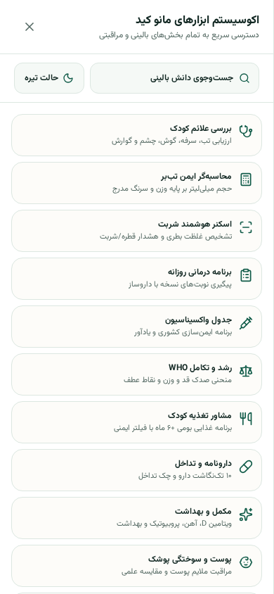

بعد — بخش بالایی فهرست گروه‌بندی‌شده و قابل پیمایش:

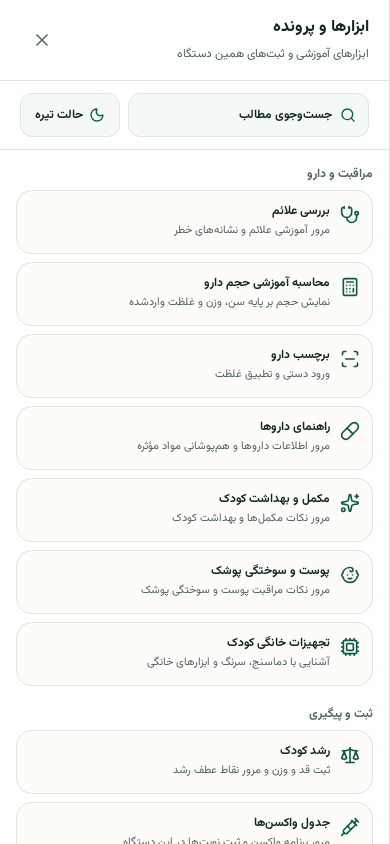

### ۴. برنامهٔ مراقبت و ثبت نوبت‌ها

**سلامت مسیر: اشکال مهمِ اعتماد اصلاح شده؛ اطلاعات واردشده همچنان تأیید بالینی نمی‌شوند.** نصب تازه قبلاً با آزیترومایسین، استامینوفن و اسپری بینی، هشت نوبت روزانه، نام داروخانه و نشان تأیید داروساز نمونه آغاز می‌شد. این ظاهر می‌توانست نمونه را با نسخهٔ واقعی اشتباه‌پذیر کند. امکان ثبت نوبت، چاپ و کپی، قابلیت‌های مفید قابل حفظ بودند.

نصب تازه اکنون بدون دارو و با شمارش صفر آغاز می‌شود و به‌روشنی «ثبت شخصی مراقب، بدون تأیید پزشک یا داروساز» است. نمونه‌های قدیمی با شناسه‌های شناخته‌شده، همراه ویرایش‌هایشان به آرشیوِ بررسی‌نشده منتقل می‌شوند و در برنامهٔ فعال یا پیشرفت امروز شمرده نمی‌شوند. داروهای سفارشی کاربر حفظ می‌شوند. مهاجرت تکرارپذیر است و اطلاعات سفارشی با پاک‌سازی مقدار دقیقِ متادیتای نمایشی حذف نمی‌شوند.

یادآور خودکار که زمان‌بند عملی نداشت، غیرفعال و با توضیح واقعی نشان داده می‌شود. زمان‌بندی و شمار نوبت در ویرایشگر از پیش پر نمی‌شود و باید وارد شود؛ از شمار نوبت، فاصلهٔ مصرف ساخته نمی‌شود. متن اشتراک‌گذاری نیز نسخه یا تأیید پزشک معرفی نمی‌شود و دستور نگهداری همگانیِ نمونه را اضافه نمی‌کند. آزمون‌های مهاجرت، حفظ اطلاعات و حالت تازه برای این رفتارها وجود دارند. پنجره‌های افزودن و ویرایش این صفحه، ارزیابی جامع صفحه‌خوان نداشته‌اند.

پیاده‌سازی: [treatmentPlan.ts](../src/domain/treatmentPlan.ts)، [treatmentPlan.test.ts](../src/domain/treatmentPlan.test.ts)، [TreatmentPlanScreen.tsx](../src/screens/TreatmentPlanScreen.tsx)، [TreatmentPlanEditorSheets.tsx](../src/components/TreatmentPlanEditorSheets.tsx).

قبل — داروها و تأیید نمونه در برنامهٔ فعال:

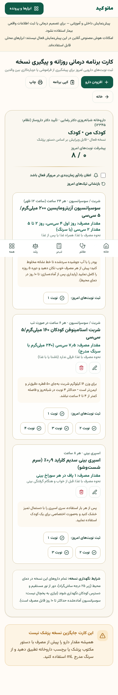

بعد — نصب تازه بدون داروی پیشنهادی:

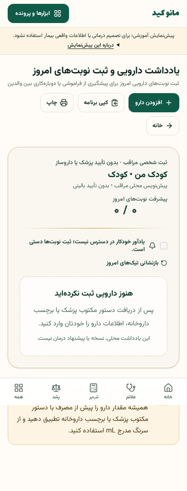

### ۵. نمایش آموزشی حجم داروی مایع

**سلامت مسیر: ادعا و واحد نمایش اصلاح شده؛ استفادهٔ بالینی مجاز نشده است.** پیش از این مرحله، خالی ماندن سن و وزن و بسته بودن محاسبه تا ورود اطلاعات، نقطهٔ قوت مهمی بود. با این حال عنوان «ایمن» و «دقیق» و تبدیل ثابت «یک سی‌سی = بیست قطره استاندارد» حتی در حالت نامعلوم، معنای بیش از حد قطعی می‌ساختند.

عنوان و متن اشتراک‌گذاری اکنون «نمایش آموزشی» را بیان می‌کنند و «بازهٔ محاسبه‌شده» جای ادعای «بازهٔ ایمن» را گرفته است. نمایش قطرهٔ عمومی حذف شده؛ واحد mL باقی است و صریحاً نوشته می‌شود تعداد قطره محاسبه نمی‌شود. در این مرحله، فرمول عددی دوز تغییر نکرده است. الزام ورود سن و وزن، تطبیق برچسب و محدودیت‌های سن پرخطر از اصلاحات پیشین حفظ شده‌اند. منابع علمیِ داخل صفحه نیز به معنی تأیید این پیاده‌سازی برای کودک خاص نیستند.

پیاده‌سازی: [FeverDoseCalculatorScreen.tsx](../src/screens/FeverDoseCalculatorScreen.tsx)، [VisualSyringeCanvas.tsx](../src/components/VisualSyringeCanvas.tsx). آزمون مرورگر نبود تبدیل ثابت قطره و وجود واحد mL را بررسی می‌کند. دقت استفاده از سرنگ در جهان واقعی یا فهم اعداد توسط مراقبان در این بررسی سنجیده نشده است.

قبل:

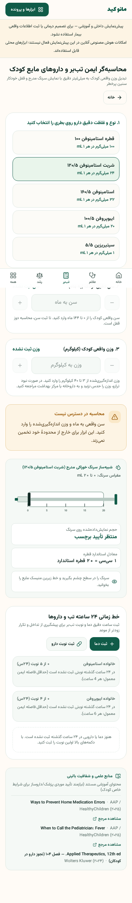

بعد:

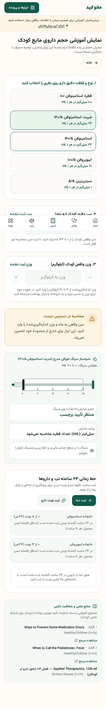

در بازبینی پایانی، برچسب پنهانِ متفاوتِ دکمهٔ هشدار نیز حذف شد تا نام دسترس‌پذیر آن همان متن قابل مشاهدهٔ «متوجه شدم» باشد. آزمون‌های مرورگر این دکمه را با متن قابل مشاهده پیدا می‌کنند و خروج صریح با Enter را می‌آزمایند.

## مبنای علمی، روان‌شناختی و صداقت بازاریابی

این منابع، دلیل انتخاب طراحی را فراهم می‌کنند. هیچ‌یک به‌تنهایی اثبات نمی‌کنند تغییر فعلی مانو، رفتار یا نتیجهٔ سلامت کاربران را بهتر کرده است.

| منبع | کاربرد مشخص در تغییر | حد استنتاج |
|---|---|---|
| [NN/g: Progressive Disclosure](https://www.nngroup.com/articles/progressive-disclosure/) | نگه داشتن دو اقدام آغازین و قراردادن ابزارهای تکمیلی در گروه‌های بازشدنی | راهنمای طراحی است؛ افزایش تبدیل این محصول را ثابت نمی‌کند. هشدار اصلی پیش‌نمایش پنهان نشده است. |
| [NN/g: Recognition Rather Than Recall](https://www.nngroup.com/articles/recognition-and-recall/) | عنوان قابل فهم، توضیح کنار ابزار و گروه‌بندی مقصدها | نیاز به آزمون پیدا کردن ابزار با کاربران فارسی‌زبان باقی است. |
| [CDC Clear Communication Index](https://www.cdc.gov/ccindex/widget.html) | پیام اصلی روشن، اقدام مشخص و بیان مستقیم محدودیت‌ها | چارچوب ارتباط سلامت است؛ برای متن فارسی این اپ امتیاز خوانایی یا فهم ساختگی محاسبه نشده است. |
| [Scheibehenne, Greifeneder & Todd، ۲۰۱۰](https://scheibehenne.de/ScheibehenneGreifenederTodd2010.pdf) | احتیاط در توجیه کم کردن گزینه‌های هم‌زمان | فراتحلیل ۵۰ مطالعه و ۶۳ وضعیت، میانگین اثر نزدیک صفر و ناهمگونی قابل توجه گزارش می‌کند. پس «گزینهٔ کمتر همیشه بهتر است» مبنای این تغییر نیست. همهٔ ۱۶ مقصد حفظ شده‌اند. |
| [Ryan & Deci، ۲۰۰۰](https://selfdeterminationtheory.org/SDT/documents/2000_RyanDeci_SDT.pdf) | اختیار رد کردن آشنایی، نبود اجبار به تکمیل پرونده برای مرور و پرهیز از فشار رفتاری | مبنای نظری خودمختاری و انگیزش است؛ شاهد افزایش ماندگاری در مانو نیست. |
| [FTC Health Products Compliance Guidance](https://www.ftc.gov/business-guidance/resources/health-products-compliance-guidance) | حذف تأیید، کارایی و قابلیت‌هایی که شواهد یا اجرای واقعی کافی برایشان وجود نداشت | معیار مرجع برای ادعاهای صریح و ضمنی سلامت در آمریکا است؛ نظر حقوقی دربارهٔ مقررات ایران نیست. |
| [WCAG 2.2 و معیارهای جدید](https://www.w3.org/WAI/standards-guidelines/wcag/new-in-22/) و [Target Size Minimum](https://www.w3.org/WAI/WCAG22/Understanding/target-size-minimum/) | تمرکز دیدنی، تلاش برای پوشیده نشدن تمرکز و کنترل‌های قابل لمس | حداقل هدف در 2.5.8 برابر ۲۴ پیکسل CSS با استثناهاست؛ هدف ۴۴ پیکسل برای چند کنترل این اپ، ادعای انطباق همهٔ کنترل‌ها یا کل WCAG نیست. |

برای بازاریابی این پیش‌نمایش، مزیت باید به رفتار قابل مشاهده محدود بماند: مرور ابزارها، ثبت محلی و فهم محدودیت‌ها. آمار استفاده، تأیید متخصص، پیشگیری قطعی از خطا، فوریت خرید یا موفقیت درمانیِ تأییدنشده به رابط اضافه نشده است. آیکون و ظاهر حرفه‌ای نیز نباید جای شاهد تأیید بالینی را بگیرند.

## اعتبارسنجی، نمایش‌های مکمل و محدودیت‌ها

| بررسی | وضعیت این نسخهٔ گزارش |
|---|---|
| TypeScript، ESLint و آزمون‌های کد | آخرین اجرای ثبت‌شدهٔ `npm run check` موفق: ۸۷ آزمون کد و ۳ آزمون وب؛ مجموع ۹۰. ESLint بدون خطا و با یک هشدار قبلیِ غیرمسدودکنندهٔ `react-refresh/only-export-components` در `ManoStore.tsx` پایان یافت؛ ادعای اجرای بدون هشدار مطرح نیست |
| ساخت تولید | `npm run build` موفق |
| مرورگر تولید | موفق روی خروجی تولید مرحلهٔ `6fe0e4e` و مجدداً پس از همسان‌سازی نام دسترس‌پذیر دکمهٔ تأیید؛ تمام آزمون‌های قبلی و دو پنجرهٔ جدید در اجرای کامل عبور کردند |
| پوشش مرورگر تأییدشده | ایمنی و حریم خصوصی قبلی؛ مهاجرت برنامه؛ ۱۶ مقصد؛ تمرکز پنجره‌ها؛ جست‌وجو؛ رد کردن آشنایی در ۳۲۰ × ۴۸۰؛ نمای نخست در عرض‌های ۳۶۰ و ۴۱۲؛ حرکت کاهش‌یافته؛ متن ۲۰۰٪؛ اولویت هشدار فوری؛ نبود تبدیل ثابت قطره |
| بازبینی مستقل کد | در تغییرات اولیهٔ منو، جست‌وجو، آشنایی، خانه و فهرست مشترک، ایراد مسدودکنندهٔ مشخص پیدا نشد؛ پنجره‌های مراقبت غیردارویی و هشدار فوری سپس به مؤلفهٔ مشترک منتقل شدند. نقش هشدار فوری، تمرکز اولیه و پیمایش محدود به نمای دید حفظ می‌شود و Escape هشدار را نمی‌بندد؛ آزمون نهایی یکپارچه نیز روی مرحلهٔ `6fe0e4e` موفق بود |
| متن بزرگ و سرصفحه | بازثبتِ مشاهده‌شده با عرض نمای دید ۳۶۰ پیکسل و اندازهٔ فونت ریشهٔ ۲۰۰٪: سرصفحه، بخش معرفی و پرونده بازآرایی شدند. این شبیه‌سازیِ متن بزرگ است؛ آزمون بزرگ‌نمایی مرورگر یا تمام تنظیمات دسترس‌پذیری سیستم‌عامل نیست |
| تمرکز با متن بزرگ | موفق در مجموعهٔ کامل Chromium روی مرحلهٔ `079a62e`؛ آزمون Tab در متن ۲۰۰٪ پوشیده شدن تمرکز را با جمع شدن فاصلهٔ پیمایش و حاشیهٔ کنترل‌ها آشکار کرد. حاشیهٔ تکراری حذف شد و اجرای دوبارهٔ مجموعهٔ مرورگر عبور کرد؛ کنترل‌های بررسی‌شده با Tab بین سربرگ ثابت و نوار پایین دیده شدند. تصویر ثابت به‌تنهایی این رفتار را اثبات نمی‌کند |
| CI مخزن | [مرحلهٔ رابط](https://github.com/mhmpharmacy-tech/Mano/actions/runs/46028297960) و [مرحلهٔ پنجره‌ها](https://github.com/mhmpharmacy-tech/Mano/actions/runs/46028722253) هر دو موفق؛ شامل بررسی کد، ساخت و Chromium |

خانه در نمایش دسکتاپ — این تصویر رفتار چیدمان را نشان می‌دهد و شاهد آزمون کاربر نیست:

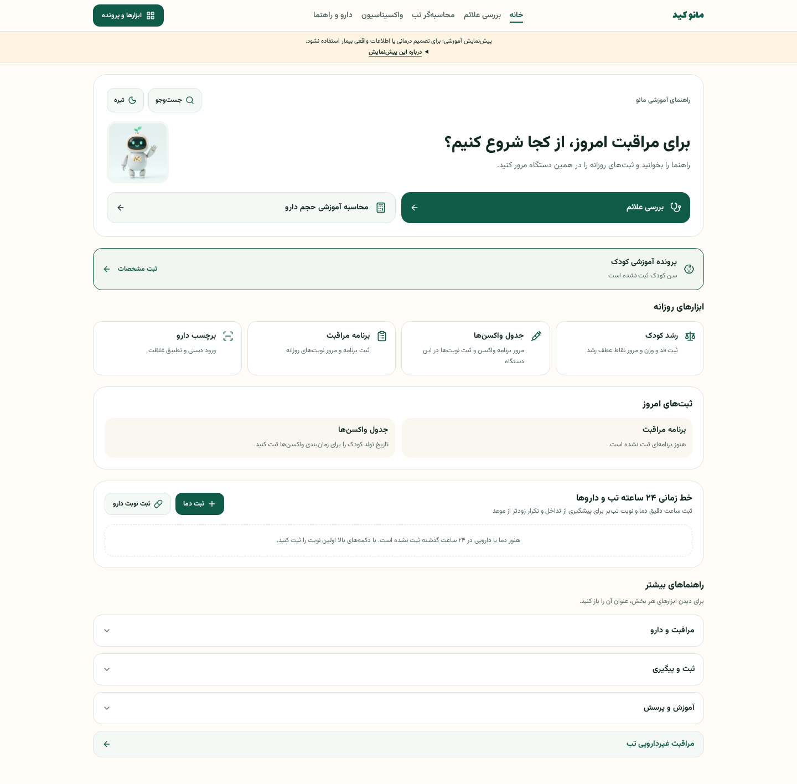

شاهد متن بزرگ پس از اصلاح و بازثبت — فونت ریشهٔ ۲۰۰٪، عرض نمای دید ۳۶۰ پیکسل. نوار ثابت پایین در ثبت تمام صفحه دیده می‌شود؛ پوشیده نشدن تمرکز باید با آزمون تعامل بررسی شود:

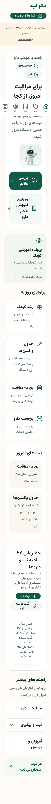

شاهد مکملِ اولویت هشدار فوری — بخشی از بررسی پنج گام بالا، با دمای ساختگی ۴۰ درجه و سن تأییدنشده، در نمای ۳۲۰ × ۴۸۰. هشدار با نقش `alertdialog` نمایش داده می‌شود؛ پیوند تماس `tel:115` وجود دارد و مسیر محاسبهٔ دوز برای سن نامعلوم نشان داده نمی‌شود. تصویر پس از پیمایش پنجره ثبت شده و دکمهٔ «متوجه شدم» در پایین آن در دسترس است. عملکرد واقعی تماس یا تصمیم بالینی از این تصویر نتیجه‌گیری نمی‌شود.

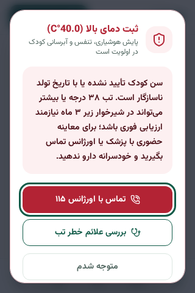

محدودیت‌های باقی‌مانده:

- آزمون کامل با صفحه‌خوان‌های واقعی، بزرگ‌نمایی و تنظیمات دستگاه، صفحه‌کلید موبایل، مرورگرهای دیگر و فناوری‌های کمکی انجام نشده است. تمرکز پنجره‌های اصلاح‌شده و چند مسیر مشخص، معادل انطباق کامل WCAG نیست.
- همهٔ صفحه‌های محصول و تمام پنجره‌های افزودن یا ویرایش، در این پنج گام ممیزی نشده‌اند. آزمون وجود مسیر، کیفیت تمام محتوای آن مسیر را اثبات نمی‌کند.
- صحت بالینی منابع، همهٔ قواعد محاسبه و تناسب محتوا با کودک خاص نیازمند بررسی و امضای مسئول بالینی مستقل است. متن آموزشی، جایگزین آن نیست.
- آزمون با مراقبان فارسی‌زبان، از جمله افراد با سواد سلامت پایین و کاربران فناوری کمکی، انجام نشده است. معیارهای مناسب مرحلهٔ بعد، پیدا کردن نخستین اقدام، فهم محدودیت ابزار، بازیابی پس از خطا و اشتباه گرفتن نمونه با نسخه‌اند؛ هیچ امتیاز یا نتیجه‌ای برای این معیارها ساخته نشده است.
- آثار بازاریابی، اعتماد، تبدیل و ماندگاری اندازه‌گیری نشده‌اند. پیش از آزمایش‌های بازاریابی، باید مرز استفاده و بررسی بالینی روشن بماند؛ اطلاعات واقعی کودک نباید برای سنجش این پیش‌نمایش جمع‌آوری شود.

آزمون‌های قابل بازاجرا در [tests/browser.mjs](../tests/browser.mjs) و اسکریپت‌های [package.json](../package.json) ثبت شده‌اند. تاریخچهٔ `main` مرجع بازیابی هر مرحله است؛ تصاویر و این گزارش، زمینهٔ تصمیم‌ها و حدود شواهد را همراه کد حفظ می‌کنند.
